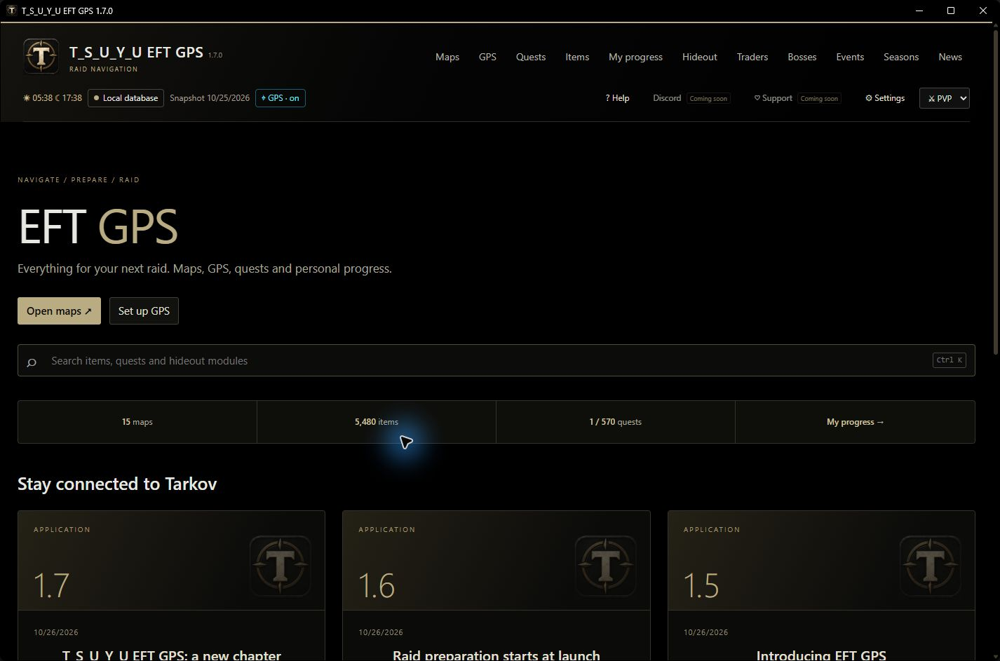
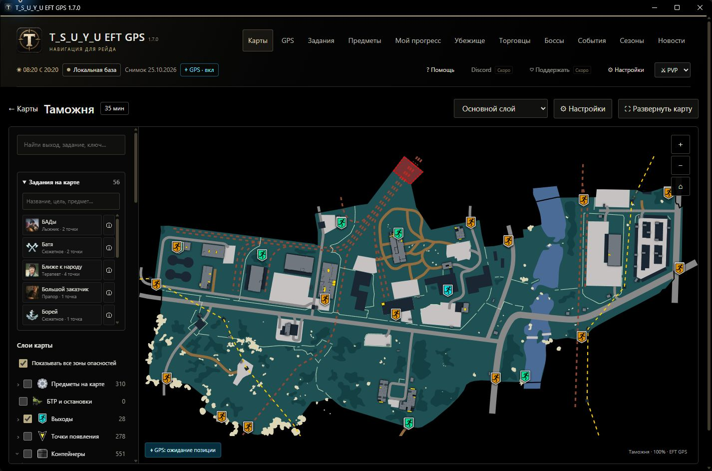

# T_S_U_Y_U EFT GPS

**Карты, задания и GPS для Escape from Tarkov — в одном бесплатном приложении.**  
**Maps, quests and screenshot GPS for Escape from Tarkov — one free application.**

  

  Нажмите на картинку — установщик скачается сразу, открывать Releases не нужно. 
  Click the image to download the latest installer directly. No need to open Releases.

  <strong>Windows 10 / 11 · x64 · Русский / English · Бесплатно / Free</strong>

**[Инструкция на русском](#ru) · [Installation in English](#en)**  
[Скачать без картинки / Direct download](https://github.com/TsuyuDX/eft-gps/releases/latest/download/EFT-GPS-Setup.exe) · [Все версии / All versions](https://github.com/TsuyuDX/eft-gps/releases) · [Сообщить об ошибке / Report a bug](https://github.com/TsuyuDX/eft-gps/issues)

---

## Установка — русский

### 1. Скачайте установщик

Нажмите большую кнопку **«Скачать для Windows»** вверху этой страницы. В загрузках браузера появится **EFT-GPS-Setup.exe**.

Для обычной установки нужен **только этот файл**. Кнопка **Code → Download ZIP** скачивает проект для работы с исходниками; для установки приложения она не нужна.

Если хотите найти файл вручную: справа на странице репозитория откройте **Releases**, выберите выпуск с пометкой **Latest**, раскройте **Assets** и нажмите **EFT-GPS-Setup.exe**. Части `.part01`, `.part02` и **Source code** выбирать не нужно — загрузчик скачает нужное сам.

### 2. Загрузите файлы приложения

Откройте **EFT-GPS-Setup.exe** из загрузок браузера или папки **«Загрузки»**. Нажмите **«Скачать и установить»** и дождитесь открытия установщика.

Полный комплект занимает около **2,6 ГБ**: время загрузки зависит от соединения. Во время загрузки доступны проценты и кнопка отмены.

### 3. Выберите папку и установите

В установщике нажмите **«Обзор…»** и выберите, где хранить программу. Внутри выбранного места автоматически создастся папка **EFT GPS**. Например, при выборе `D:\Games` приложение установится в `D:\Games\EFT GPS`.

Оставьте галочку **«Создать ярлык на рабочем столе»**, если хотите запускать приложение с рабочего стола. Затем нажмите **«Далее»**, проверьте путь и нажмите **«Установить»**.

После начала операции появятся **проценты, текущий файл, прошедшее время и примерное оставшееся время**. Подробный журнал открывается кнопкой **«Подробнее»**. При отмене дождитесь сообщения о завершении отмены.

Когда появится **100%**, нажмите **«Открыть приложение»**.

Язык установщика выбирается по Windows. Переключить его можно кнопками **RU / EN** справа вверху. Нужные компоненты проверяются автоматически; отдельные драйверы GPS устанавливать не нужно.

### 4. Первый запуск

Выберите **«Русский»** или **English** в самом приложении. Дождитесь проверки локальных данных и пройдите короткий обзор. Повторно открыть его можно через **«Помощь»**.

Выберите режим **PvP** или **PvE**. Карты и справочник доступны без интернета после установки.

Для GPS откройте раздел **GPS** и проверьте папку внутриигровых скриншотов. Если она не найдена, сделайте скриншот в Tarkov и укажите его папку. Автосъёмка включается вручную. GPS показывает последнюю позицию из скриншота; между снимками положение не обновляется непрерывно.

### Как обновлять

При запуске приложение один раз проверяет новую версию. Если обновление есть, внизу появится полоса загрузки. После скачивания откроется окно **«Обновление приложения»**: нажмите **«Обновить приложение»** и подтвердите действие.

Текущая папка определяется автоматически. **Прогресс, метки и настройки сохраняются.** Начиная с 1.8.0 скачиваются только изменения, если для вашей версии подготовлен небольшой пакет. Иначе используется полный комплект. Для автоматического перехода с 1.7.1–1.7.2 полный комплект потребуется один раз.

Для ручного обновления скачайте установщик кнопкой выше и через **«Обзор…»** выберите **существующую папку приложения** — ту, где лежит **EFT GPS.exe**. Новая вложенная папка в этом случае не создаётся. Перед ручной установкой закройте приложение. Версии 1.7.0 и старше обновляются вручную.

### Если возникла проблема

| Что произошло | Что сделать |
| --- | --- |
| Скачался ZIP с исходниками | Вернитесь к кнопке скачивания вверху. Нужен **EFT-GPS-Setup.exe**. |
| Загрузка прервалась | Откройте загрузчик снова и нажмите **«Повторить»**. Проверенные части используются повторно. |
| Не найдена папка скриншотов | Укажите её в разделе **GPS**. Карты и справочник доступны и без настроенного GPS. |
| Не хватает места | Выберите диск с достаточным свободным местом для приложения и временных файлов. |
| Обновление не завершается | Дождитесь сообщения об ошибке или отмене. Откройте **«Подробнее»** и приложите текст ошибки к [сообщению о проблеме](https://github.com/TsuyuDX/eft-gps/issues/new). Не публикуйте личные данные. |

**Системные требования:** Windows 10 версии 1903 или новее либо Windows 11, **x64**; .NET Framework 4.7.2 или новее. Совместимость проверяет установщик. Проект находится в раннем доступе: возможны ошибки.

---

## Installation — English

### 1. Download the installer

Click the large **Download for Windows** image at the top of this page. Your browser will download **EFT-GPS-Setup.exe**.

This is the **only file needed for normal installation**. **Code → Download ZIP** downloads the project source; it is not needed to install the application.

To find the file manually, open **Releases** on the right side of the repository page, select the release marked **Latest**, expand **Assets**, and click **EFT-GPS-Setup.exe**. Do not select the `.part01`, `.part02` files or **Source code**. The downloader handles the package parts automatically.

### 2. Download the application files

Open **EFT-GPS-Setup.exe** from your browser downloads or your **Downloads** folder. Click **Download and install**, then wait for setup to open.

This step requires internet. The complete package is approximately **2.6 GB**, so download time depends on your connection. The downloader shows percentages and lets you cancel.

### 3. Choose a folder and install

Click **Browse…** and select where to store the application. An **EFT GPS** subfolder will be created automatically. For example, selecting `D:\Games` installs the app in `D:\Games\EFT GPS`.

Keep **Create a desktop shortcut** checked if you want a shortcut. Click **Next**, check the folder, then click **Install**.

Once installation starts, you will see the **percentage, current file, elapsed time and estimated remaining time**. Technical logs are hidden under **Details**. If you cancel, wait for the cancellation to finish.

At **100%**, click **Open application**.

Setup initially uses your Windows language. Switch with **RU / EN** in the upper-right corner. Required components are checked automatically; no separate GPS drivers are needed.

### 4. First launch

Choose **English** or **Русский** in the application. Wait for local data checks, then follow the brief introduction. You can replay it from **Help**.

Select **PvP** or **PvE**. Maps and reference data work offline after installation.

For GPS, open **GPS** and check the in-game screenshots folder. If it is missing, take a screenshot in Tarkov and select its folder. Enable automatic capture manually. GPS shows the last position read from a screenshot; it does not continuously track movement between screenshots.

### Updating

The application checks for a new version once at startup. An available update downloads with a progress bar at the bottom. After downloading, the **Application update** window opens. Click **Update application** and confirm.

The current installation folder is detected automatically. **Your progress, markers and settings are preserved.** From 1.8.0, only changed files are downloaded when a matching incremental package is available; otherwise a full package is used. Versions 1.7.1–1.7.2 need one full automatic upgrade to receive the new mechanism.

To update manually, download the installer using the image above and use **Browse…** to select your **existing application folder**, containing **EFT GPS.exe**. An extra nested folder is not created in this case. Close the application before manual installation. Version 1.7.0 and earlier require a manual upgrade.

### Troubleshooting

| Problem | What to do |
| --- | --- |
| You downloaded a source ZIP | Use the download image at the top. You need **EFT-GPS-Setup.exe**. |
| A download was interrupted | Reopen the downloader and click **Retry**. Verified parts are reused. |
| The screenshots folder was not found | Select it in **GPS**. Maps and reference data also work without GPS configured. |
| Not enough disk space | Choose a drive with enough free space for the application and temporary files. |
| An update fails | Wait for the error or cancellation to finish. Open **Details** and include the error text in an [issue](https://github.com/TsuyuDX/eft-gps/issues/new). Do not publish personal data. |

**Requirements:** Windows 10 version 1903 or later, or Windows 11, **x64**; .NET Framework 4.7.2 or later. Setup checks compatibility. This is an early-access project and may contain bugs.

---

<strong>Скриншоты приложения / Application screenshots</strong>

## Помощь и поддержка / Help and support

[Сообщить об ошибке / Report a bug](https://github.com/TsuyuDX/eft-gps/issues) · [История версий / Release history](https://github.com/TsuyuDX/eft-gps/releases) · [Для разработчиков / Development](GIT-CHECKOUT.md)

[Разовый донат / One-time donation](https://boosty.to/tsuyueftgps/donate) · [Подписка / Membership](https://boosty.to/tsuyueftgps/purchase/4150607)

Поддержка добровольна; приложение бесплатно. Discord — скоро.  
Support is optional; the application is free. Discord — coming soon.

Игровые материалы принадлежат Battlestate Games. Независимый фанатский проект.  
Game materials belong to Battlestate Games. An independent fan project.
