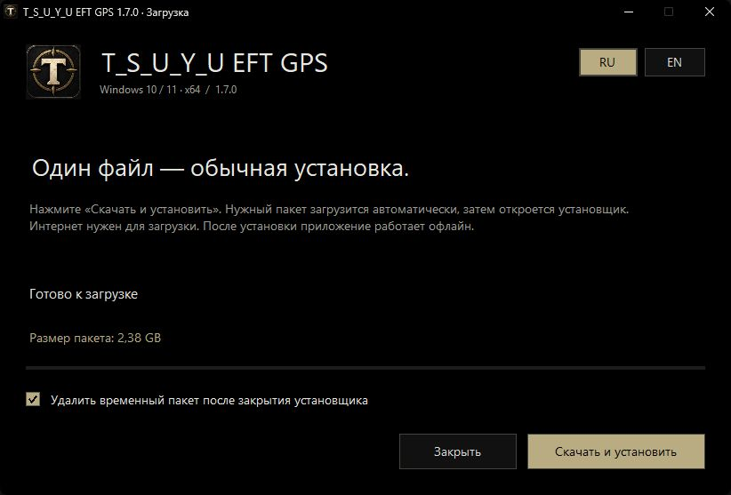
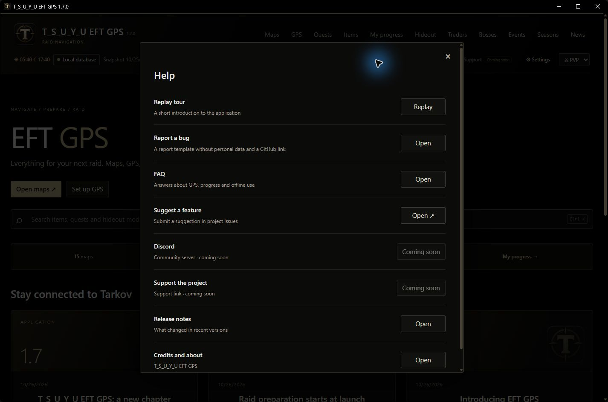
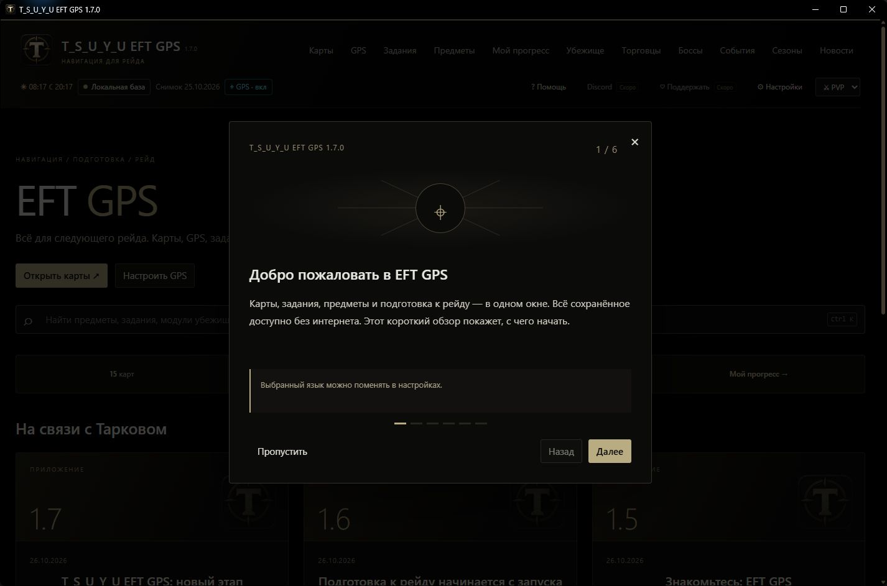

# T_S_U_Y_U EFT GPS

**Карты, GPS по игровым скриншотам и подготовка к рейду. Бесплатное приложение для Windows.**  
**Offline maps, screenshot GPS and raid preparation. Free Windows app.**

[Все версии / All versions](https://github.com/TsuyuDX/eft-gps/releases) · [Сообщить об ошибке / Report a bug](https://github.com/TsuyuDX/eft-gps/issues/new/choose) · [Поддержать / Support](https://boosty.to/tsuyueftgps)

**T_S_U_Y_U · Windows 10/11 x64 · Русский / English · Ранний доступ / Early access**

## Скачать и установить

1. Нажмите большую кнопку **«Скачать / Download»** выше. Нужен один небольшой файл **EFT-GPS-Setup.exe**.
2. Откройте его и нажмите **«Скачать и установить»**. Загрузчик сам скачает части пакета, проверит SHA-256 и откроет установщик.
3. Выберите место установки: внутри создастся папка **EFT GPS**. Нажмите **«Далее → Установить»**. При обновлении выберите уже существующую папку: прогресс, настройки и личные метки сохраняются.

Для первой загрузки нужен интернет. После установки карты, справочник и GPS работают офлайн. Полный комплект занимает несколько гигабайт; загрузчик показывает объём и прогресс. Язык установщика определяется по Windows; язык приложения выбирается отдельно.

**В приложении возможны ошибки:** проект находится в раннем доступе. Пишите о проблемах и предложениях в [Issues](https://github.com/TsuyuDX/eft-gps/issues).

**1.8.0:** ускоренная установка, небольшие пакеты обновлений, проценты и время установки, скрытый журнал и безопасная отмена. / Faster setup, incremental updates, percentage and time estimates, collapsed details and cancellation with rollback.

## Возможности / Features

- Интерактивные карты, этажи, зоны опасностей и отдельные фильтры типов меток и контейнеров.
- Задания с целями, ключами, сохранёнными прохождениями и иллюстрациями. Поиск по названиям и инструкциям.
- GPS по новым внутриигровым скриншотам: последняя определённая позиция и её возраст.
- Автосъёмка только при активном окне игры. Очистка обработанных скриншотов текущего сеанса по желанию.
- Локальный справочник предметов, торговцев, боссов, событий, убежища и трекер предметов.
- Отдельный PvP/PvE-прогресс, заметки, личные метки и экспорт резервной копии.
- Русский и английский интерфейс, справочник и сохранённые руководства.
- Проверка запуска, поиск папок игры, первый обзор и раздел помощи.
- Начиная с **1.7.1**: проверка обновления один раз при запуске, автоматическая загрузка с процентами и отдельный режим обновления текущей папки с сохранением данных.

## Download and install

1. **[Download EFT-GPS-Setup.exe](https://github.com/TsuyuDX/eft-gps/releases/latest/download/EFT-GPS-Setup.exe).** This is the only download needed for normal installation.
2. Run it and choose **Download and install**. Parts are downloaded and verified automatically.
3. Choose an application folder. For an update, select your existing folder to preserve personal data.

Requires **Windows 10 version 1903 or newer / Windows 11, x64**, .NET Framework 4.7.2 or newer. Node.js, production dependencies and the offline WebView2 installer are bundled; no separate GPS drivers are required. This early-access application may contain bugs.

From **1.7.1**, the app checks the latest stable GitHub release once at startup, downloads newer versions with a bottom progress bar, and opens a dedicated update window for the current installation directory. Checksums are verified before installation. A failed check or download leaves the current application available offline. Install 1.7.1 manually once to enable updates from older builds.

## GPS: что важно / GPS limitations

GPS читает координаты из имён **новых внутриигровых скриншотов**. Он показывает последнюю определённую позицию, а не непрерывное движение между снимками. Приложение не читает память игрового процесса и не отслеживает других игроков или ботов. Статические метки — справочные данные карты.

Если путь не найден автоматически, сделайте скриншот в игре и выберите его папку в разделе GPS. Автосъёмка включается вручную после запуска. Проверяйте время последнего определения позиции. Очистка удаляет обработанные снимки сеанса автосъёмки, включая ручные снимки этого сеанса; старые снимки и файлы вне сеанса сохраняются.

GPS uses newly created in-game screenshot filenames. It shows the last screenshot position, not continuous movement or other players. Automatic capture is enabled manually per session. Optional cleanup applies only to processed screenshots from that capture session; older screenshots remain untouched.

## Офлайн и сохранения / Offline data and saves

Карты, данные и изображения хранятся локально. Цены, события и шансы появления отражают сохранённую базу, а не текущие значения в игре. Некоторые иллюстрации могут отсутствовать; полнота руководств зависит от сохранённых материалов.

Настройки, прогресс и GPS хранятся в **userdata**. Эта папка не публикуется в Git. Сохраняйте её при переносе установленного приложения и используйте экспорт прогресса перед тестированием старой версии. GitHub получает запрос проверки версии, но не ваши координаты, скриншоты или прогресс.

Maps, reference data and saved illustrations are local. Prices and events reflect the saved snapshot. Keep **userdata** when moving the installed app; export progress before testing an old version. Personal data is not included in this repository or sent in update checks.

## Для разработки и ноутбука / Development

Основная ветка содержит полный проект: исходники, карты, данные, runtime и production-зависимости. После Clone запустите **Start EFT GPS.cmd**. Отдельный npm install для обычного запуска не нужен. Для дальнейшей работы используйте **development**; изменения сохраняйте коммитами.

Исторические снимки помечены тегами **app-v1.0.0, app-v1.1.0, app-v1.4.0, app-v1.5.0, app-v1.6.0, app-v1.7.0** и **v1.7.1**. Все промежуточные коммиты сохранены; частичные контрольные коммиты первой загрузки не являются готовыми версиями для запуска. Версии 1.2 и 1.3 отдельно не сохранились и не воссоздавались.

Первоначальная история только с исходниками сохранена в ветке **archive/original-source-history**. Для запуска используйте полные снимки, а не эту архивную ветку.

Старые теги v1.5.0–v1.7.0 сохранены без перезаписи: они относятся к прежней странице документации. Для полных исходников соответствующих версий используйте теги **app-v...**. Старые выпуски могут работать иначе, чем текущая версия.

Clone the full repository and run **Start EFT GPS.cmd**. Use completed version tags for rollback, rather than partial upload checkpoints. Export personal progress separately and close the app before switching versions. Archived downloadable packages are rebuilt from verified historical snapshots; original local archives were retained unchanged.

## Помощь и сообщество / Help and community

**Ctrl+K** — поиск / search · **Esc** — закрыть карточку / close details · **Колесо / Wheel** — масштаб / zoom · **Перетаскивание / Drag** — перемещение карты / pan.

Discord и Ko-fi **скоро будут доступны / coming soon**.

Разовый донат: **[Boosty](https://boosty.to/tsuyueftgps/donate)**. Подписка: **[Поддержать разработку](https://boosty.to/tsuyueftgps/purchase/4150607)**. Поддержка добровольна; приложение и стабильные обновления бесплатны. Подписчики Boosty видят анонсы нововведений на три дня раньше их открытой публикации. Никнеймы в благодарностях публикуются только с согласия.

Game-related names and materials belong to Battlestate Games. EFT GPS is an independent fan project. Official game news: [Escape from Tarkov](https://www.escapefromtarkov.com/).
